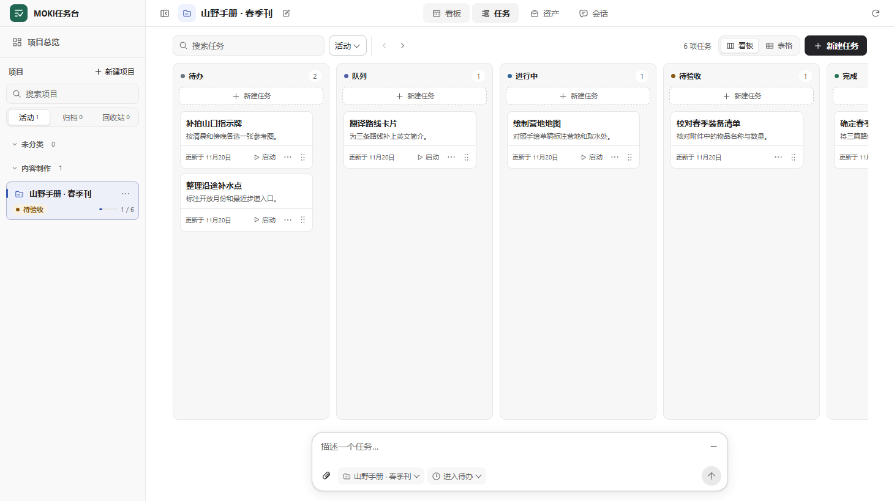

# MOKI Taskboard for Codex

[English](README.md) · [简体中文](README.zh-CN.md) · [Releases](https://github.com/JKZeng-cell/moki-taskboard/releases)

**Windows · Codex plugin v0.2.23 · MIT**

Keep the brief, input files, agent session and deliverables on one task card. For a field-guide project, queue the route translations, attach a sketch to the map task, then review the packing list alongside the files the agent delivered.

| When you want to… | Use Taskboard to… |
| --- | --- |
| Plan work | Group cards by status, from backlog through review and completion, or switch to a table. |
| Start an agent | Run a task now, queue it, or set a weekly work window. Resume a project session or start a new one. |
| Hand off inputs | Drop in files or paste screenshots. Each run records the input versions it actually received. |
| Review a delivery | Open the files, check the requirements, then accept the task or request another pass with comments and attachments. Earlier deliveries remain available. |
| Revisit progress | Link sessions within a chosen scope and follow the source conversation. Select a day, week or month to see which tasks changed. |

The project database and managed files live on your machine. Agent execution and optional semantic session matching send the relevant context through the host and model you select, using your account's model allowance.



## Install

Use Codex Desktop for Windows, a Codex CLI with plugin commands, and Node.js 24 or newer on the desktop process PATH. Restart the desktop app after installing Node.

```powershell
codex plugin marketplace add JKZeng-cell/moki-taskboard
codex plugin add moki-taskboard@moki-plugins
```
In the plugin directory choose MOKI Plugins and open MOKI Taskboard for Codex (listed as MOKI任务台 for Codex). Create a project, choose its working folder and add a task. For a local install, extract the release ZIP and use the extracted folder in place of the repository name above.

## Build from source

```powershell
npm ci --ignore-scripts
npm run typecheck
npm test
npm run build
npm run build:dsh
node --experimental-strip-types --test ports/dsh/adapter.test.mjs
```

[DSH edition and downloads](https://github.com/JKZeng-cell/moki-taskboard-for-dsh)

[项目配图与文案 · Launch media kit](https://github.com/JKZeng-cell/moki-taskboard/tree/v0.2.23/media/launch)
