# MOKI任务台 for Codex

[English](README.md) · [简体中文](README.zh-CN.md) · [Releases](https://github.com/JKZeng-cell/moki-taskboard/releases)

**Windows · Codex plugin v0.2.23 · MIT**

把 Codex 会话里的需求收进项目，给任务附上输入文件，再打开交付物验收。下面以「山野手册 · 春季刊」为例，跟一张北线补水卡从编辑讨论走到定稿。

[安装](#install) · [项目与任务](#projects) · [会话自动归集](#capture) · [快捷提交](#quick) · [资产与版本](#files) · [交付验收](#review)

[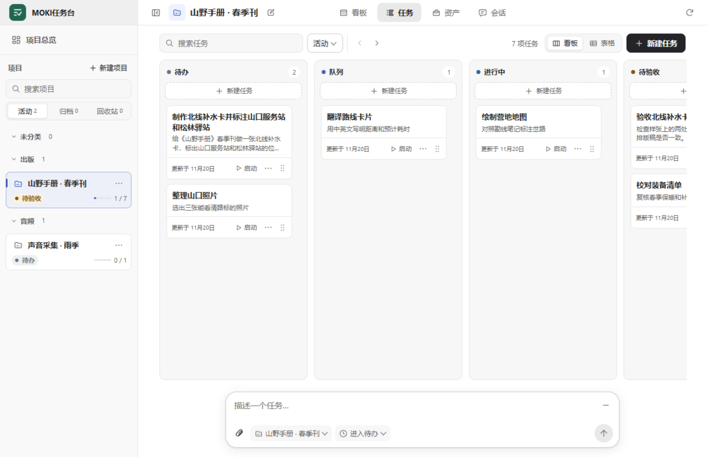](media/walkthrough/zh/04-board.webp)

<a id="projects"></a>

## 从项目总览进入本期手册

先在侧栏点「项目总览」。从项目进度表找到有待验收任务的「山野手册 · 春季刊」，点击这一行进入项目。

[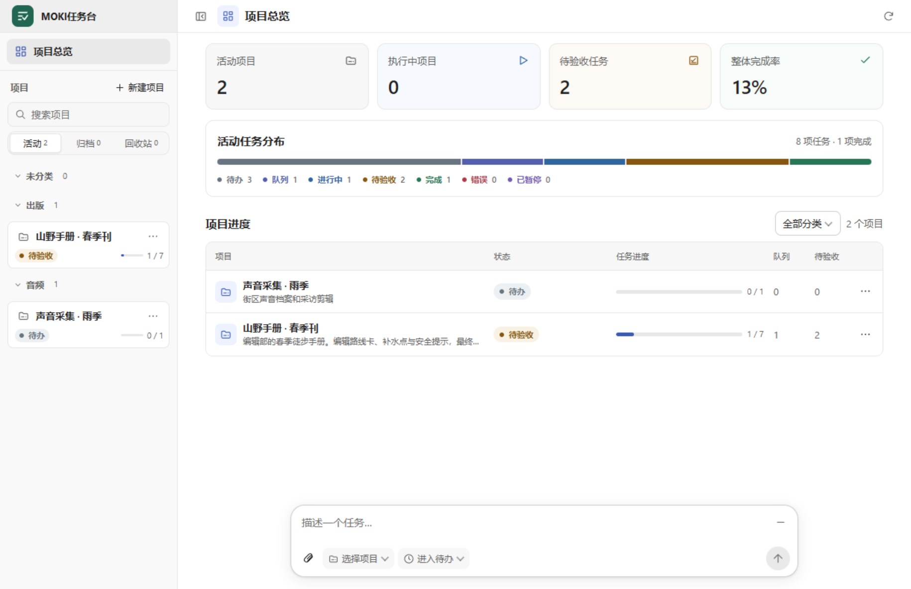](media/walkthrough/zh/01-portfolio.webp)

项目看板显示本期任务进度和最近的「勘线初稿」上线记录。在下方「任务活动」切换日、周、月，再点一个时间格，就能看到这段时间变动过的任务。

[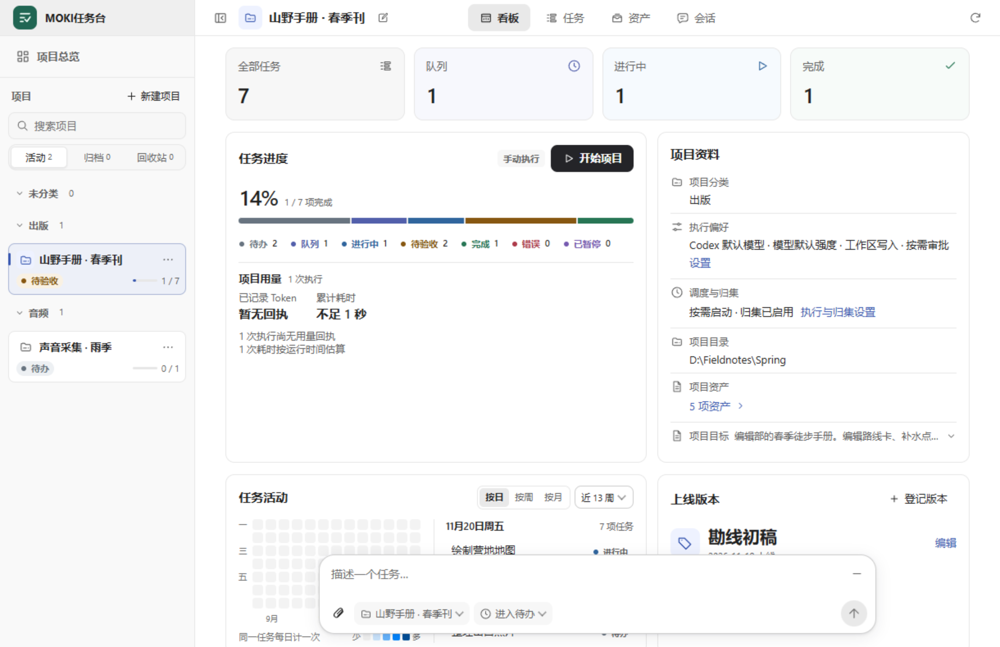](media/walkthrough/zh/02-dashboard.webp)

<details>
<summary>展开查看选中一周后的完整界面</summary>

[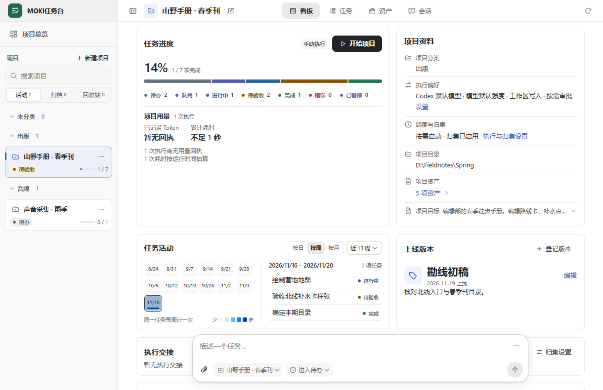](media/walkthrough/zh/03-activity.webp)

</details>

在「任务」页把视图从看板切到「表格」，同一组任务按行排列。逐行比较状态和输入资产数，点任务名称可看说明与附件。

[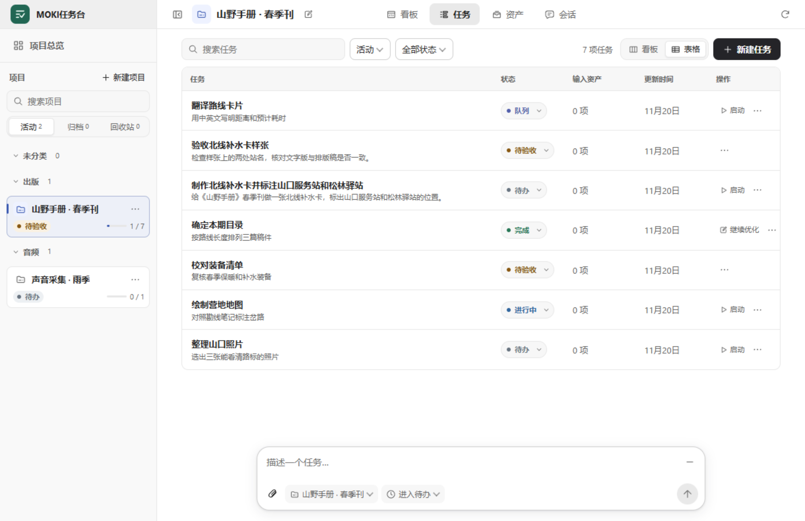](media/walkthrough/zh/05-table.webp)

<a id="capture"></a>

## 会话里的一句话，如何变成项目待办

在「会话 → 归集设置」开启语义归集并选择扫描范围。示例限定为项目目录及附加目录，所选宿主和模型会处理该范围内的相关会话。

[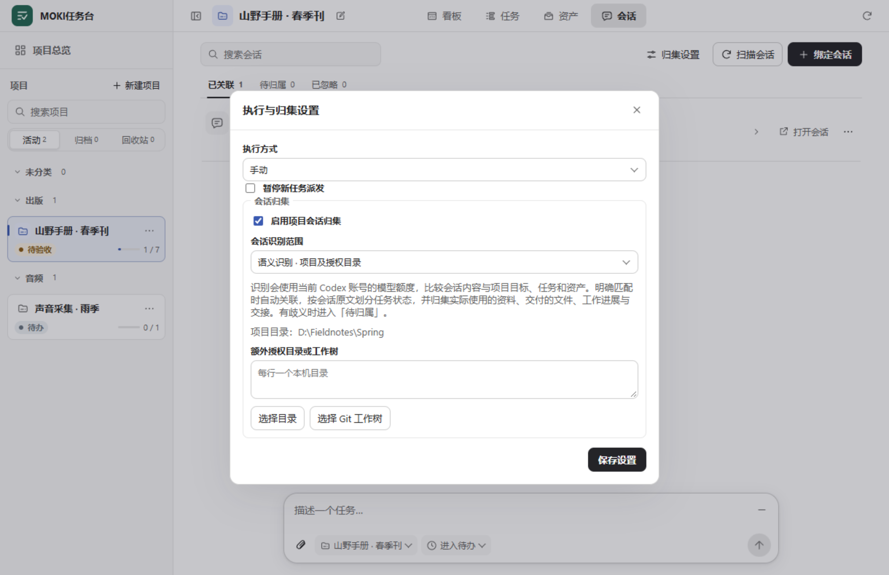](media/walkthrough/zh/06-scope.webp)

编辑在会话里提出「给《山野手册》春季刊做一张北线补水卡，标出山口服务站和松林驿站的位置。」展开已归集的会话，可同时看到归属依据、引用原话和自动建立的任务。

[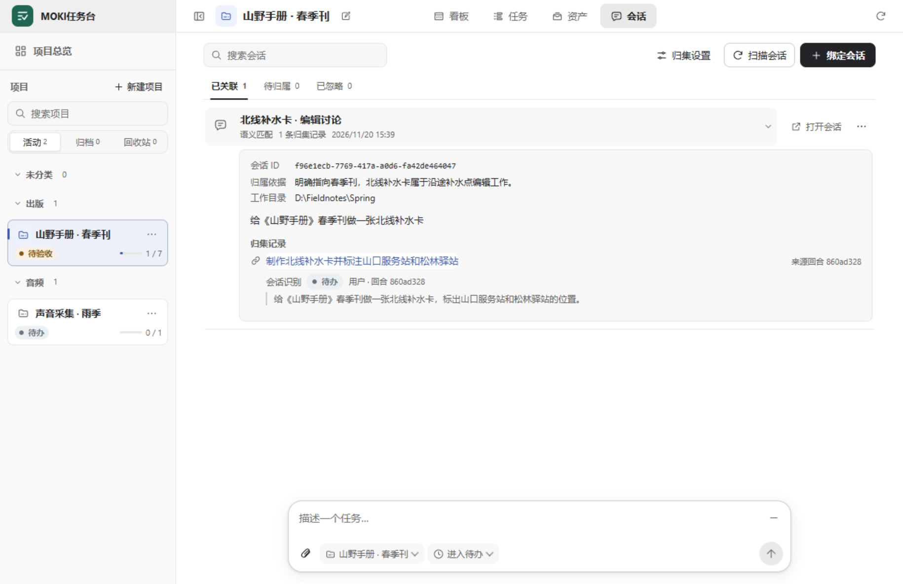](media/walkthrough/zh/07-session.webp)

直接点会话记录里的「制作北线补水卡并标注山口服务站和松林驿站」。打开的是项目中的待办卡，「来源会话」保留原话，接手的人可以追溯需求。

[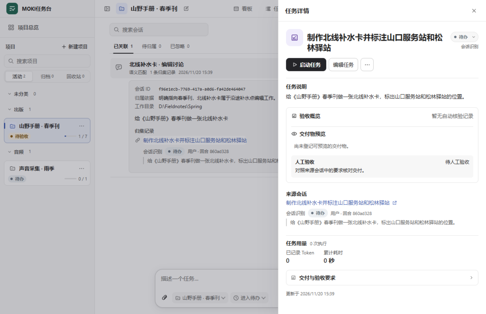](media/walkthrough/zh/08-source-task.webp)

<a id="quick"></a>

## 在当前页写任务，带上附件一起提交

在底部输入框首行写「校对北线路线卡」，下一行填校对要求，再添加「北线路线卡.md」。选中春季刊和「进入待办」，按 **Ctrl+Enter**。看板随即多出一张卡。点「查看任务」并展开「关联输入」，可以看到固定的 **v1**。

[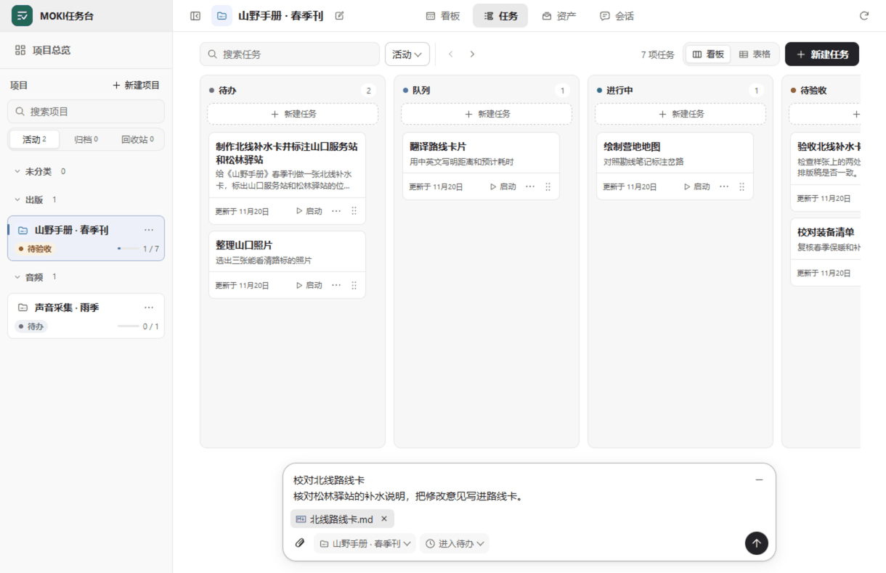](media/walkthrough/zh/quick-submission.gif)

逐帧查看　[填写与附件](media/walkthrough/zh/09-quick-draft.webp) · [待办与回执](media/walkthrough/zh/10-quick-created.webp) · [任务与 v1](media/walkthrough/zh/11-quick-input.webp)

<a id="files"></a>

## 从资产列表取回指定版本

打开「资产」，展开「路线勘察记录.md」旁的版本记录。同一个文件下面列出 v2 和 v1，每行都有预览入口，可以核对当时的稿件。

[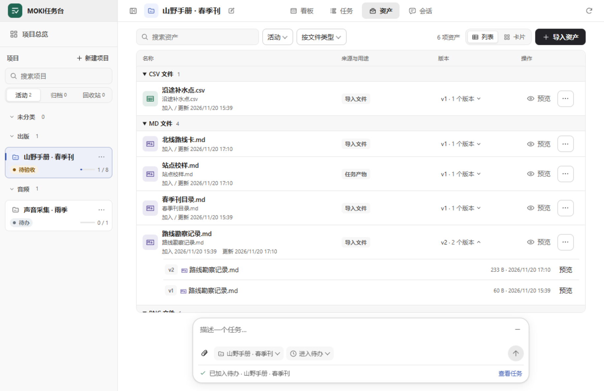](media/walkthrough/zh/12-versions.webp)

<a id="review"></a>

## 打开交付样张，再决定通过还是补改

在「待验收」打开「验收北线补水卡样张」，点「验收本次执行」。同一窗口能看 PNG 缩略图、Markdown 文字校样和逐项核验。示例有六项自动检查通过，仍由编辑核对两处站名并给出人工结论。

[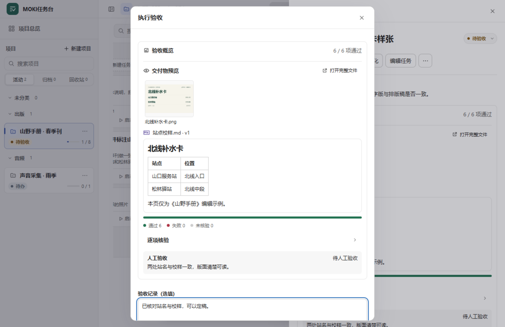](media/walkthrough/zh/14-review.webp)

<details>
<summary>展开查看放大样张与验收按钮</summary>

[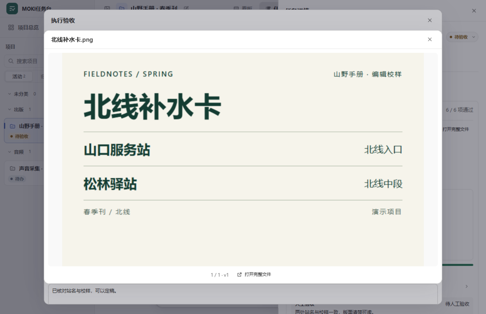](media/walkthrough/zh/14b-proof.webp)

[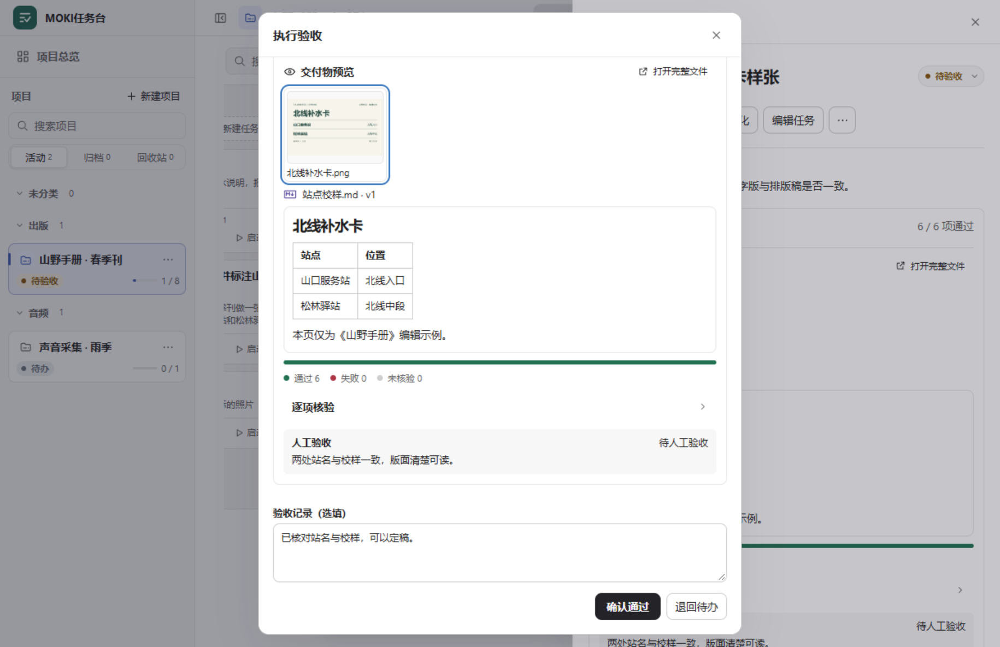](media/walkthrough/zh/14c-decision.webp)

</details>

写下验收记录并点「确认通过」，任务状态随即变为「完成」，原交付和结论仍在详情中。若需要退回待办，可在同一验收窗口选择该操作。

[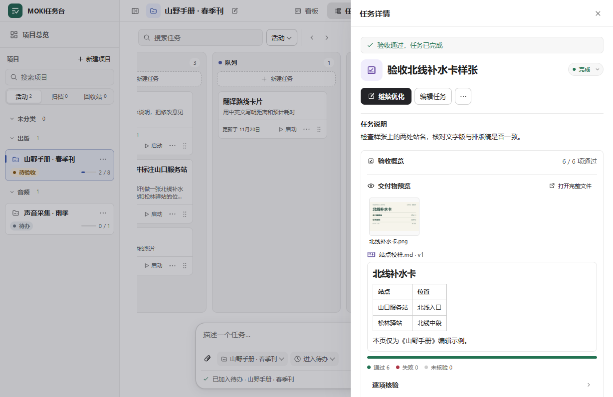](media/walkthrough/zh/15-accepted.webp)

要在上一轮交付基础上改稿，可点「继续优化」，补充「把两处站名加粗」，附上排版意见并选择执行会话。图中是提交前的草稿，提交后会携带补充要求和上一轮产物开始下一轮。

[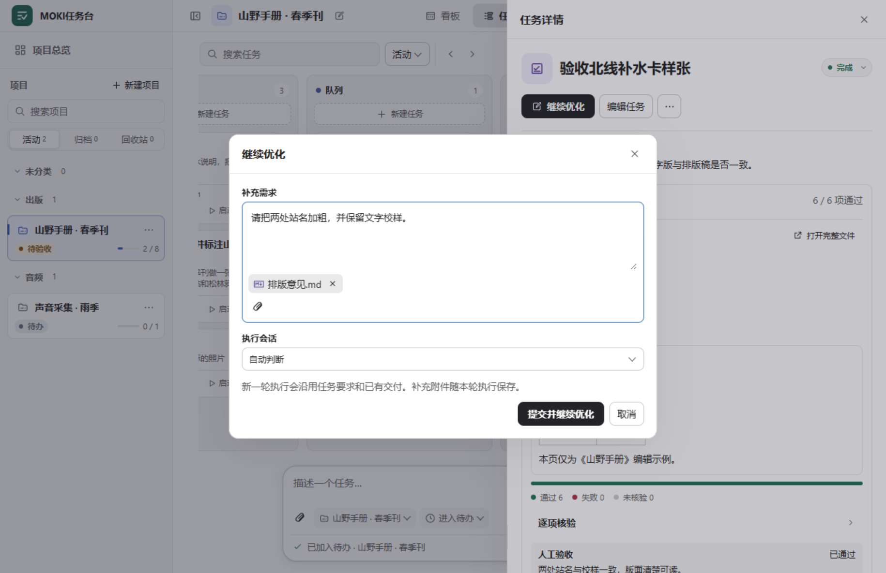](media/walkthrough/zh/16-refine.webp)

<a id="install"></a>

## 安装


使用 Windows Codex 桌面、支持插件命令的 Codex CLI 和 Node.js 24 或更高版本。确保桌面进程能在 PATH 中找到 node；首次安装 Node 后重启桌面应用。

```powershell
codex plugin marketplace add JKZeng-cell/moki-taskboard
codex plugin add moki-taskboard@moki-plugins
```
在插件目录选择 MOKI Plugins，打开「MOKI任务台 for Codex」。先建一个项目，选择工作目录，再添加第一张任务卡。也可下载 Release 的 ZIP，解压后用解压目录替代第一条命令中的仓库名。

## 从源码构建

```powershell
npm ci --ignore-scripts
npm run typecheck
npm test
npm run build
npm run build:dsh
node --experimental-strip-types --test ports/dsh/adapter.test.mjs
```

[DSH 版与安装包](https://github.com/JKZeng-cell/moki-taskboard-for-dsh)

项目库与托管文件保存在本机。启动 Agent 或使用语义归集时，所选宿主和模型会处理相关内容，并使用该账号的模型额度。

[中文发布图集与小红书文案](https://github.com/JKZeng-cell/moki-taskboard/tree/main/media/launch/field-guide) · [下载图文包](https://github.com/JKZeng-cell/moki-taskboard/releases/download/v0.2.23/moki-taskboard-visual-guide-zh-v2.zip)

截图来自发行版插件面板，使用隔离的中文示例项目和编辑校样。
