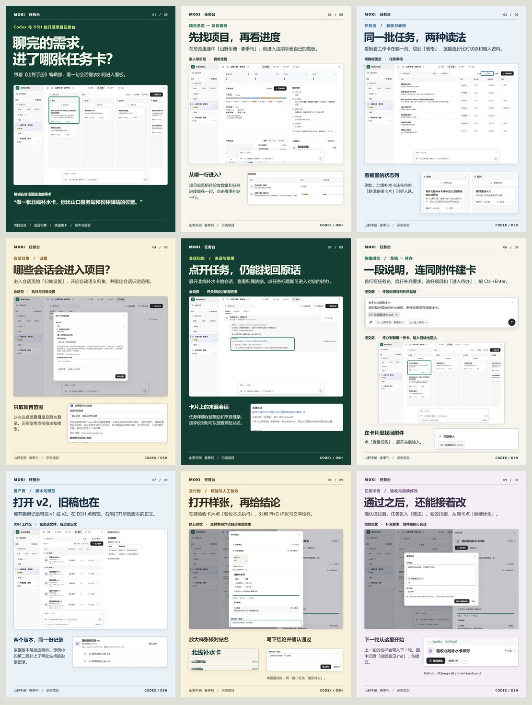

# MOKI任务台 · 从会话到交付

《山野手册》编辑部在会话里提了一张北线补水卡。九张图记录它如何进入项目，以及怎样带附件建卡、核对文件版本和验收校样。

[Codex 完整界面](https://github.com/JKZeng-cell/moki-taskboard/blob/main/README.zh-CN.md) · [DSH 完整界面](https://github.com/JKZeng-cell/moki-taskboard-for-dsh/blob/main/README.zh-CN.md) · [功能介绍](功能介绍.md) · [小红书文案](小红书文案.md) · [下载九图和离线界面导览](https://github.com/JKZeng-cell/moki-taskboard/releases/download/v0.2.23/moki-taskboard-visual-guide-zh-v2.zip)

| 配图 | 展示内容 |
| --- | --- |
| [01　聊完的需求，进了哪张任务卡？](carousel/01-cover.png) | 沿着《山野手册》的北线补水卡，从编辑讨论看到项目里的待办。 |
| [02　先找项目，再看进度](carousel/02-project.png) | 从总览的项目行进入春季刊，在看板读任务进度与上线记录。 |
| [03　同一批任务，两种读法](carousel/03-tasks.png) | 在看板按状态找工作，切表格逐行对照状态和输入资产数。 |
| [04　哪些会话会进入项目？](carousel/04-capture-scope.png) | 在会话页打开归集设置，选定项目目录和附加目录的识别范围。 |
| [05　点开任务，仍能找回原话](carousel/05-capture-result.png) | 查看会话归属依据，点击自动生成的任务，回查编辑提到的两处站点。 |
| [06　一段说明，连同附件建卡](carousel/06-quick-submit.png) | 底部写任务、添加路线卡，按 Ctrl+Enter。看新增待办、回执和 v1 关联输入。 |
| [07　打开 v2，旧稿也在](carousel/07-files.png) | 展开勘察记录的版本。在 DSH 左侧保留资产列表，右侧阅读 v2 的 Markdown 表格。 |
| [08　打开样张，再给结论](carousel/08-review.png) | 对照 PNG 和文字校样，查看六项自动核验，再写下人工结论。 |
| [09　通过之后，还能接着改](carousel/09-refinement.png) | 查看完成状态，从原卡打开继续优化，补要求、挂附件、选本轮执行会话。 |

实拍版本为 Windows 版 MOKI任务台 for Codex 0.2.23 和 for DSH 0.1.12。截图使用隔离示例项目，图文中的交付物为编辑校样。
