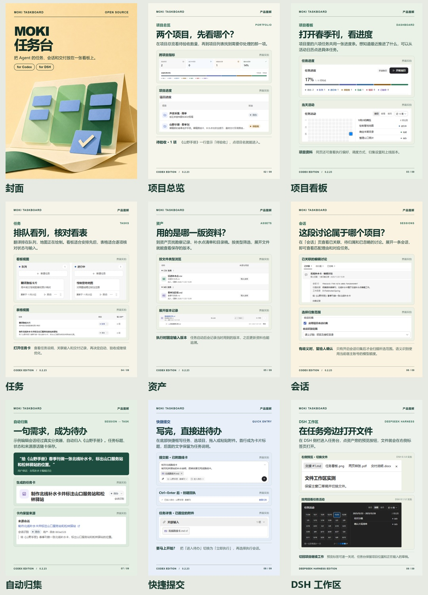
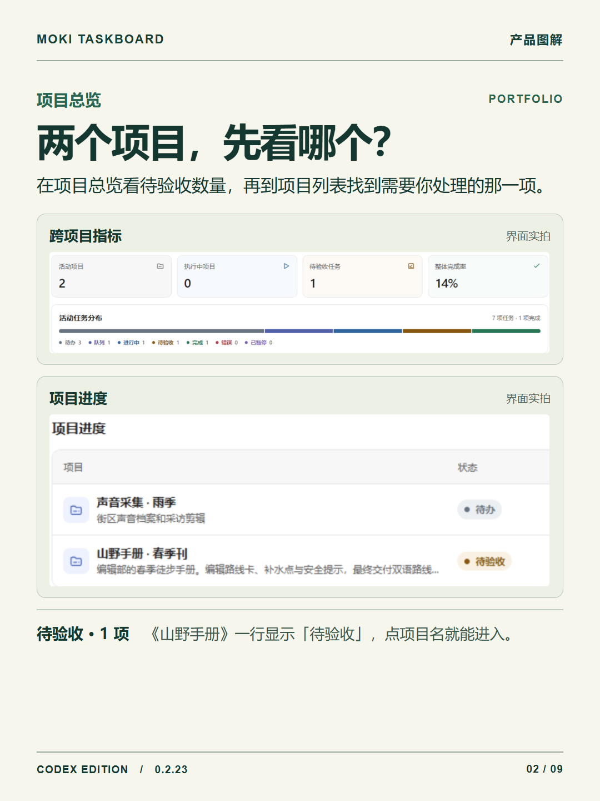
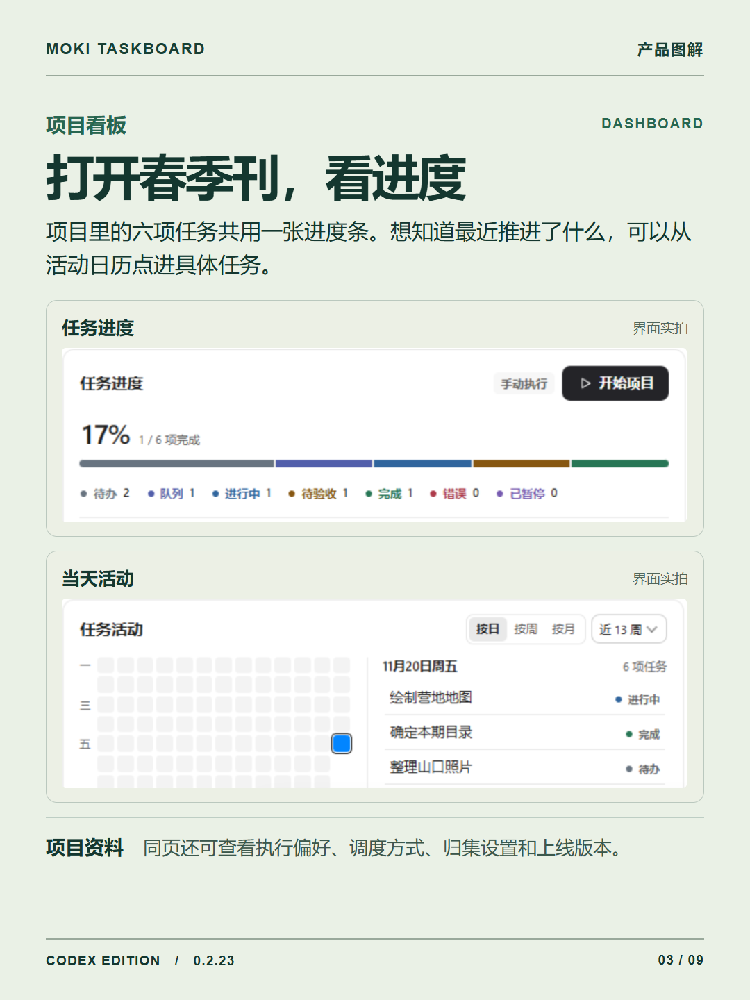
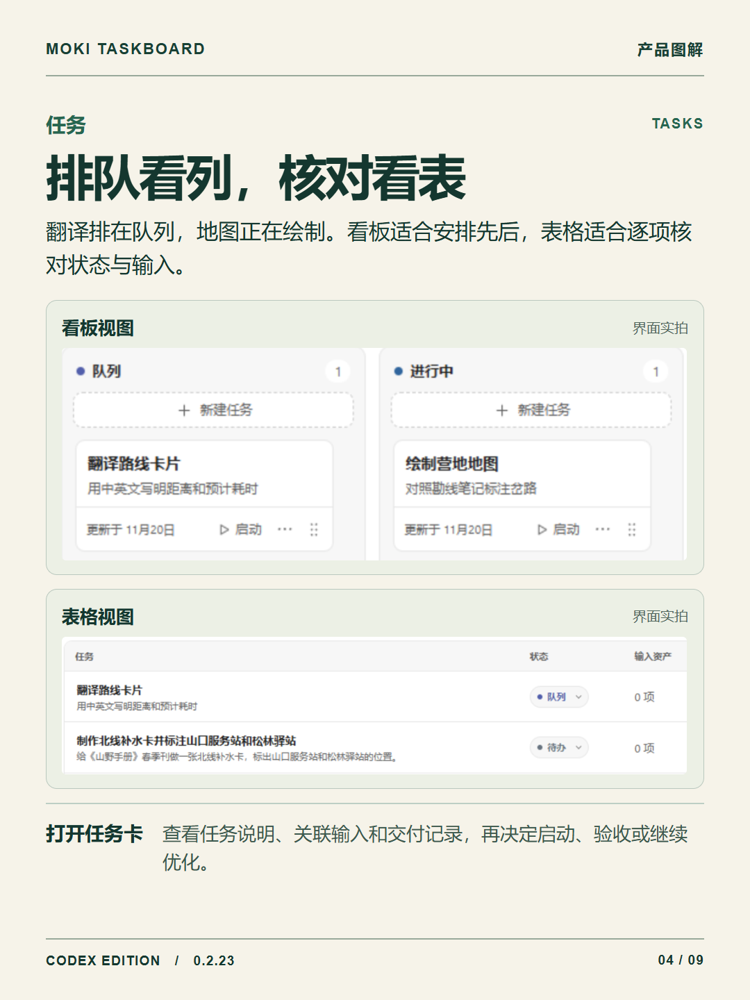
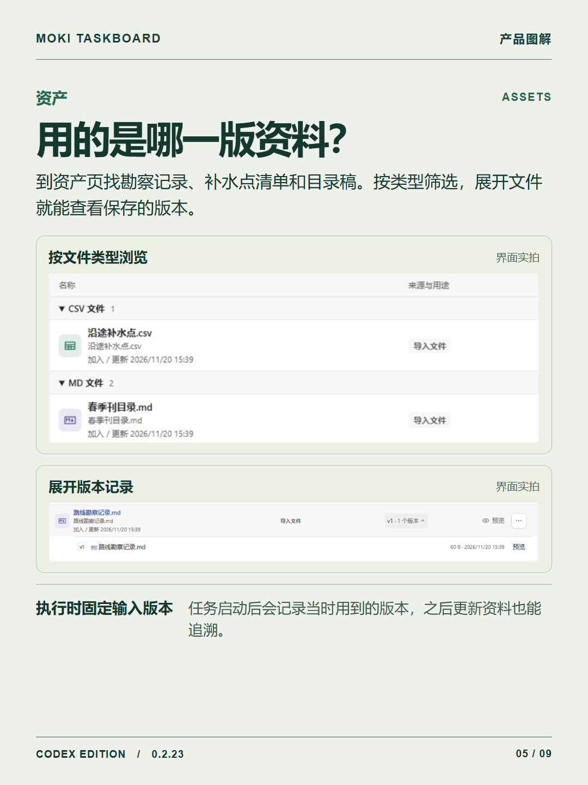
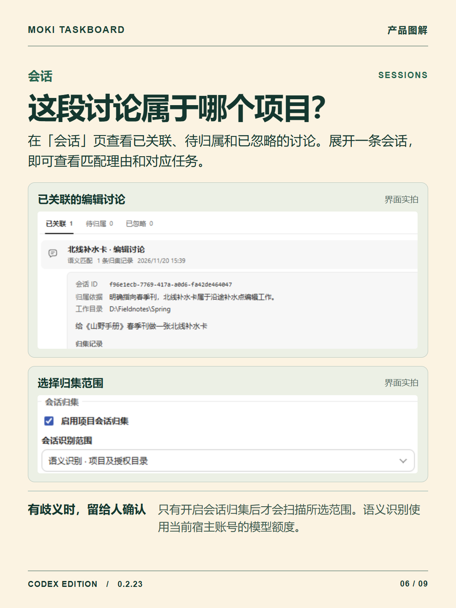
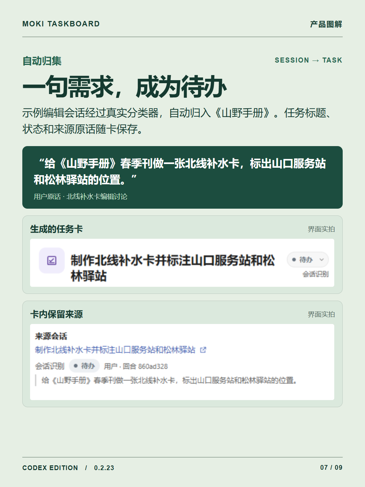
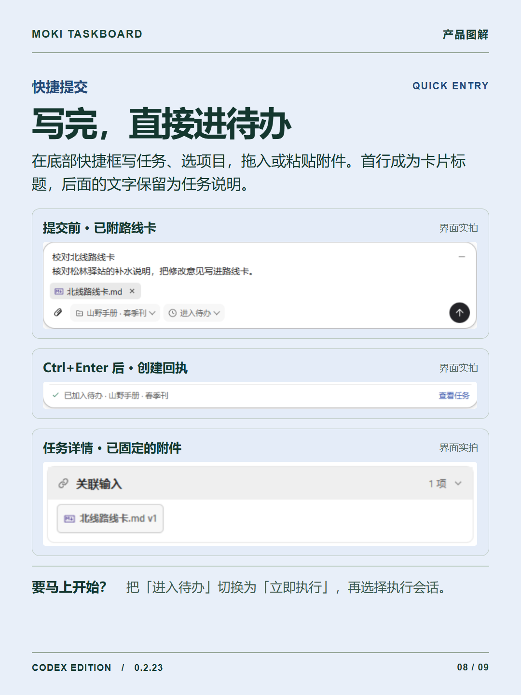
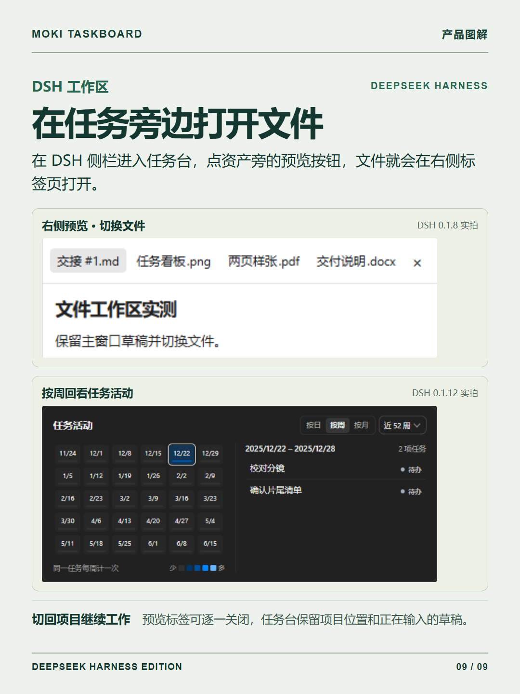

# MOKI Taskboard · Illustrated tour

[English](README.en.md) · [简体中文](README.md)

Follow a spring field guide through the five main screens, then see a conversation become a task and a draft become a card with an attachment. The final plate shows the DSH file workspace. The screenshots use the Chinese interface.

[九张原图 ZIP / Download the nine plates](https://github.com/JKZeng-cell/moki-taskboard/releases/download/v0.2.23/moki-taskboard-gallery-zh.zip)

## Portfolio

Compare projects and open the one waiting for review.

[总览 / Portfolio](screens/01-portfolio.png)

## Project dashboard

Inspect progress, task activity and release notes within the field-guide project.

[看板 / Dashboard](screens/02-dashboard.png)

## Tasks

Move between the status board and the table to plan work or compare task inputs.

[分列 / Board](screens/03-board.png) · [表格 / Table](screens/04-table.png)

## Assets

Expand a field note to inspect its file version.

[版本 / Versions](screens/05-assets.png)

## Sessions

Open the editorial discussion to see why it belongs to the project and which task came from it.

[关联会话 / Linked session](screens/06-sessions.png) · [归集设置 / Scope](screens/08-capture-settings.png)

## Automatic capture

The real classifier matched a sample conversation to the project and created a to-do with the original request attached.

[关联会话 / Linked session](screens/06-sessions.png) · [生成的任务 / Captured task](screens/07-captured-task.png)

## Quick entry

Submit a brief and an attachment with Ctrl+Enter. The resulting card keeps both the instructions and version 1 of the file.

[草稿 / Draft](screens/09-quick-draft.png) · [提交后 / Receipt](screens/10-quick-created.png) · [关联输入 / Attachment](screens/11-quick-detail.png)

## DSH workspace

Open files in preview tabs next to the board, or select a week to see which tasks changed.

[每周活动 / Week view](dsh-activity-screenshot.png)

Codex images show v0.2.23 running against an isolated sample project. DSH captures show the file preview from v0.1.8 and weekly activity from v0.1.12.
