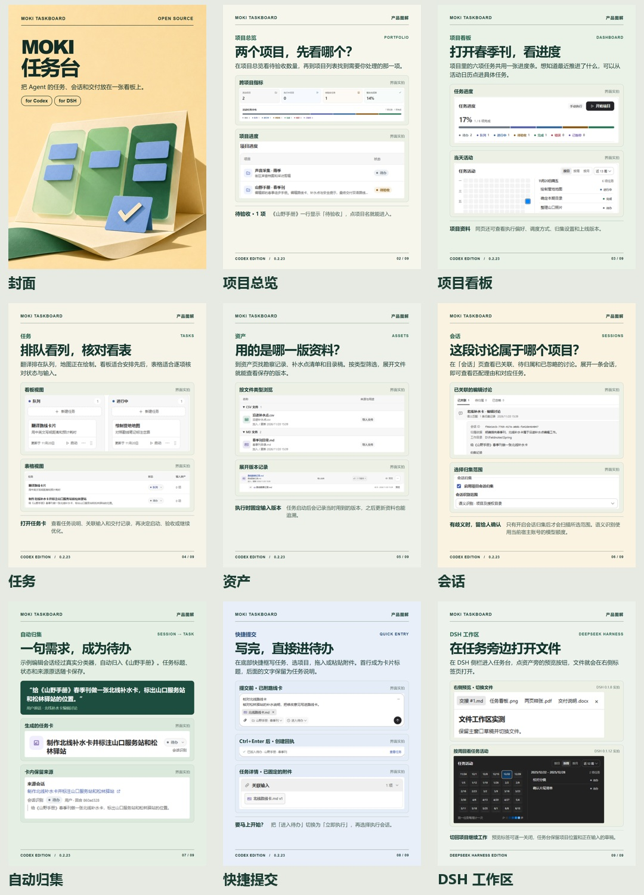
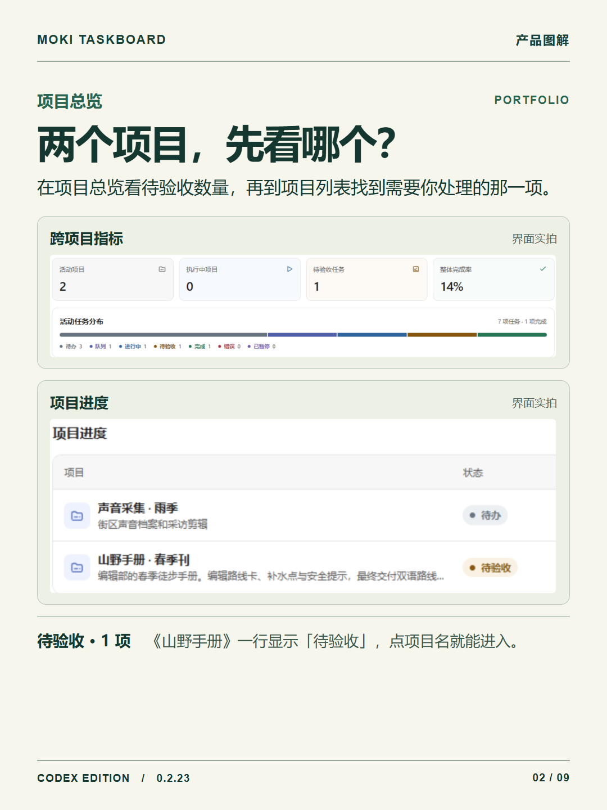
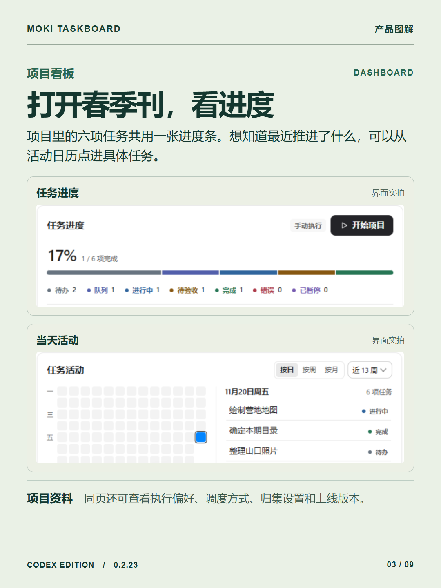
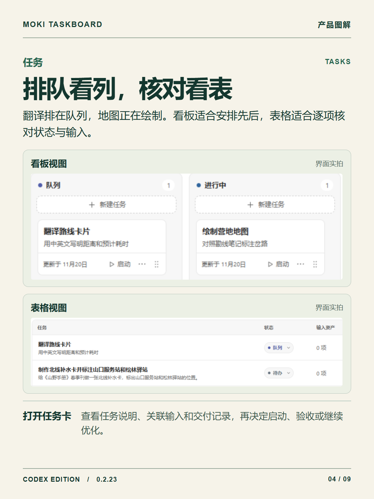
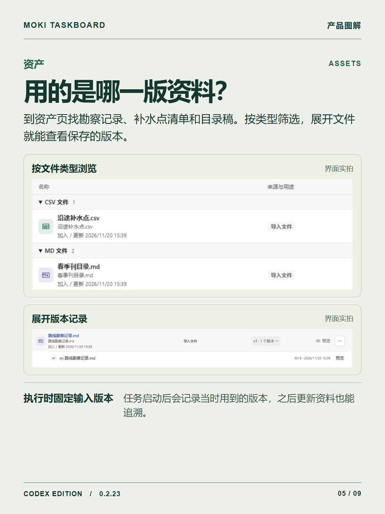
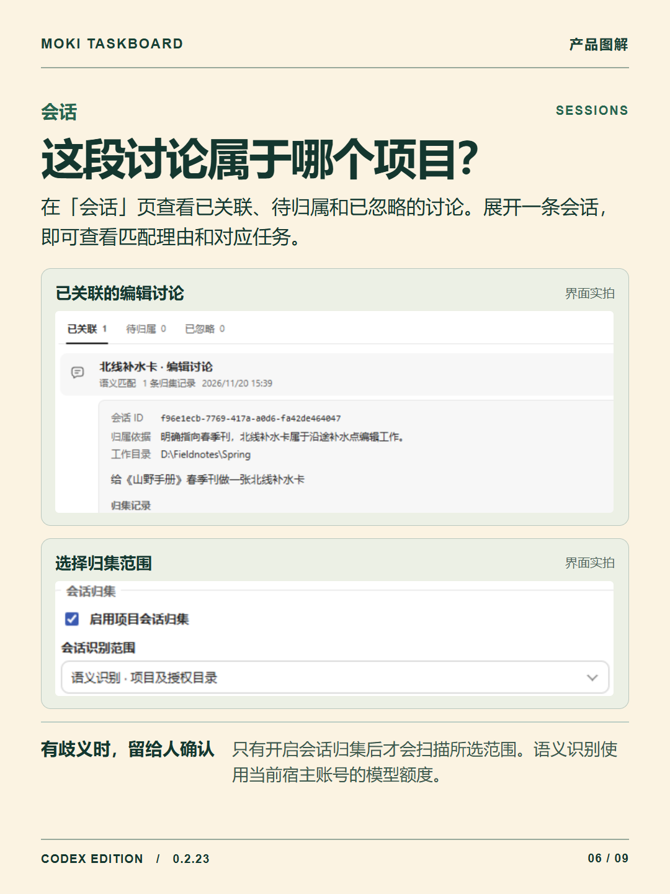
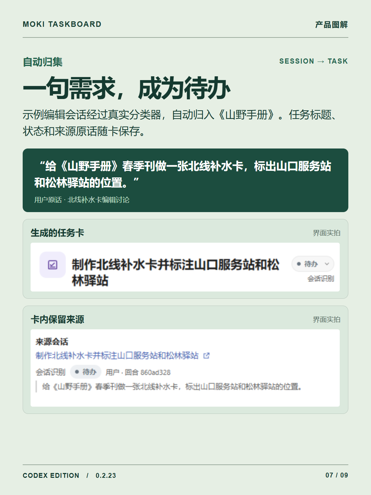
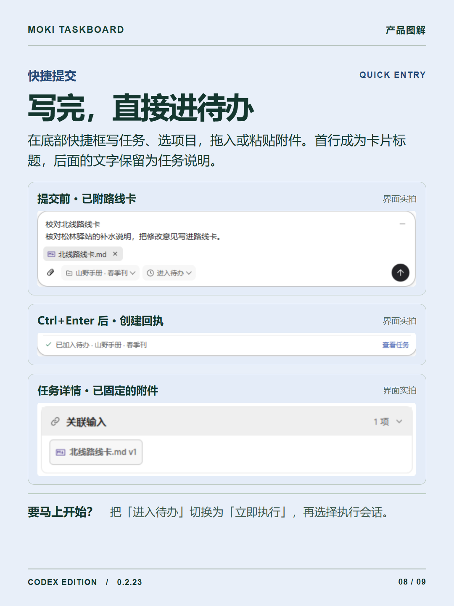
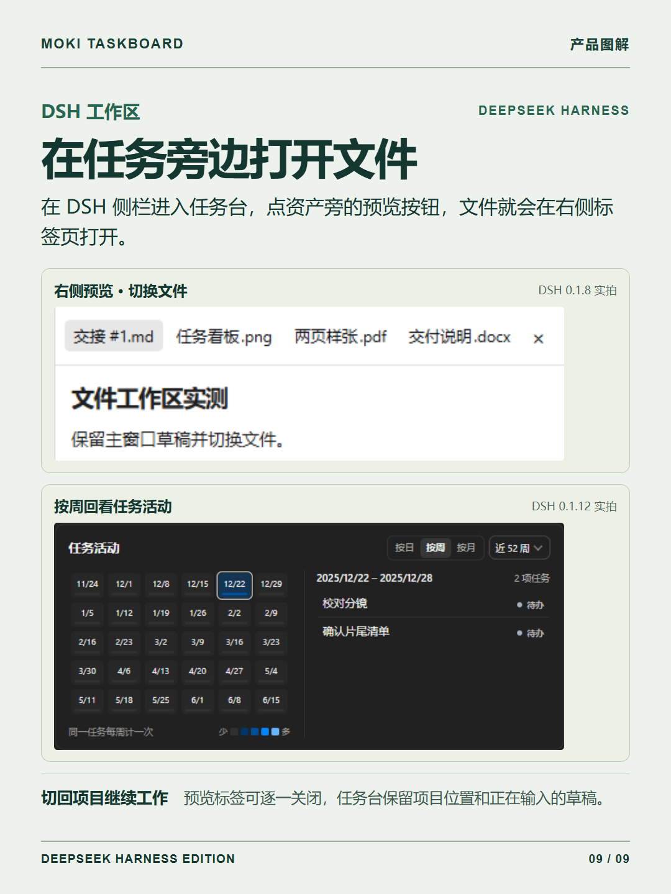

# MOKI任务台 · 九图导览

[查看新版发布图文与完整界面](../field-guide/README.md)

[English](README.en.md) · [简体中文](README.md)

前五个功能页展示同一本春季刊的项目数据。接下来用两张图拆解自动归集和快捷提交，最后一张展示 DSH 的独立预览区。

[九张原图 ZIP / Download the nine plates](https://github.com/JKZeng-cell/moki-taskboard/releases/download/v0.2.23/moki-taskboard-gallery-zh.zip)

## 项目总览

先看哪项工作等验收，再进入对应项目。

[总览 / Portfolio](screens/01-portfolio.png)

## 项目看板

切到《山野手册》，核对当前进度、活跃任务与上线版本。

[看板 / Dashboard](screens/02-dashboard.png)

## 任务

看板用于安排任务，表格用于逐项对照状态和输入。

[分列 / Board](screens/03-board.png) · [表格 / Table](screens/04-table.png)

## 资产

展开勘察记录，查看文件版本。

[版本 / Versions](screens/05-assets.png)

## 会话

打开编辑讨论，查看语义匹配依据和归集记录。

[关联会话 / Linked session](screens/06-sessions.png) · [归集设置 / Scope](screens/08-capture-settings.png)

## 自动归集

示例对话经真实分类器归入项目，新建一张待办，并保留用户的来源原话。

[关联会话 / Linked session](screens/06-sessions.png) · [生成的任务 / Captured task](screens/07-captured-task.png)

## 快捷提交

从底部快捷框添加说明和附件，按 Ctrl+Enter，查看待办与固定输入版本。

[草稿 / Draft](screens/09-quick-draft.png) · [提交后 / Receipt](screens/10-quick-created.png) · [关联输入 / Attachment](screens/11-quick-detail.png)

## DSH 工作区

切换任务旁的文件预览页签，或在项目看板按周查看任务。

[每周活动 / Week view](dsh-activity-screenshot.png)

取材说明：Codex 图片来自 0.2.23 在隔离示例项目中的实际界面。DSH 图片使用 0.1.8 的文件预览和 0.1.12 的周活动验收截图。
